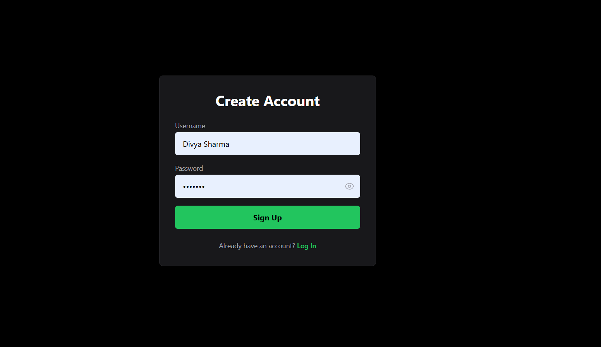
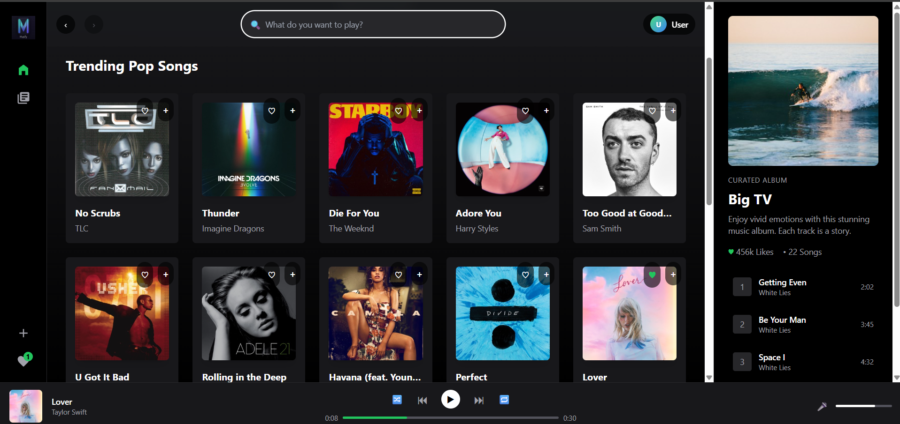
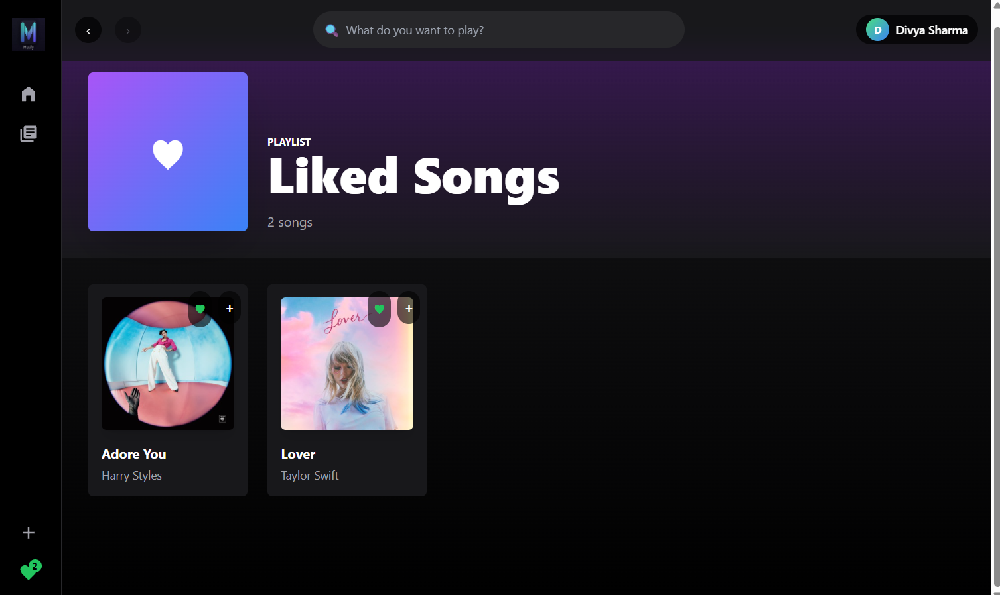

# 🎵 Musify - Full Stack Music Streaming Application
A full-stack music player built using React and Django REST Framework


A modern, Spotify-inspired music streaming web application built with a robust Full-Stack architecture. Musify allows users to discover music, create personalized playlists, like their favorite tracks, and enjoy a seamless audio playback experience with secure authentication.

🔗 **Live Demo:** [Insert Vercel/Render Link Here]
💻 **Source Code:** [Insert GitHub Link Here]

---

## 📸 Screenshots

| Signup | Home & Discovery |
| :---: | :---: |
|  |  |

| Library | LikedSongs |
| :---: | :---: |
|  |  |

---

## ✨ Features

*   **🔐 Secure Authentication:** JWT (JSON Web Token) based secure login and registration system.
*   **🎧 Seamless Audio Playback:** Custom-built audio player with Play, Pause, Next, Previous, Shuffle, and Repeat functionality.
*   **❤️ Like & Save Songs:** Users can like their favorite tracks, which are instantly synced to the cloud database.
*   **📂 Custom Playlists:** Create, manage, and organize songs into personalized playlists.
*   **🔍 Real-time Search:** Integrated with iTunes Search API for dynamic music discovery.
*   **📱 Responsive UI:** Beautiful, dark-themed UI built with Tailwind CSS, fully responsive across devices.
*   **☁️ Cloud Database:** Persistent data storage using PostgreSQL (Supabase), ensuring data safety.

---

## 🛠️ Tech Stack

### **Frontend**
*   **React.js** (State Management, Hooks, Component Architecture)
*   **Tailwind CSS** (Styling, Responsive Design)
*   **Axios** (API requests, JWT Interceptors)

### **Backend**
*   **Django & Django REST Framework (DRF)** (RESTful APIs, Serializers, ViewSets)
*   **JWT Authentication** (`djangorestframework-simplejwt`)
*   **PostgreSQL** (via Supabase for production-grade cloud database)
*   **CORS & Environment Variables** (Secure configuration)

### **External APIs**
*   **iTunes Search API** (For fetching real-time music metadata and 30-second previews)

---

## 🚀 Installation & Setup

Follow these steps to run the project locally:

### **1. Clone the Repository**
```bash
git clone https://github.com/Divyu-codes/music_player.git
cd music_player

📂 Project Structure
my_music_player/
├── backend/
│   ├── api/            # DRF Views, Serializers, Models
│   ├── music_player/   # Django Settings, URLs
│   ├── .env            # Environment Variables
│   └── manage.py
└── frontend/
    ├── src/
    │   ├── components/ # UI Components (Player, Sidebar, Cards)
    │   ├── utils/      # Axios configuration
    │   └── App.jsx     # Main Application Logic
    └── public/         # Static assets (Logo, Favicon)

    👨‍💻 Author
Divya
GitHub: @Divyu-codes
LinkedIn: [Your LinkedIn Profile Link]
Made with ❤️ and lots of ☕.